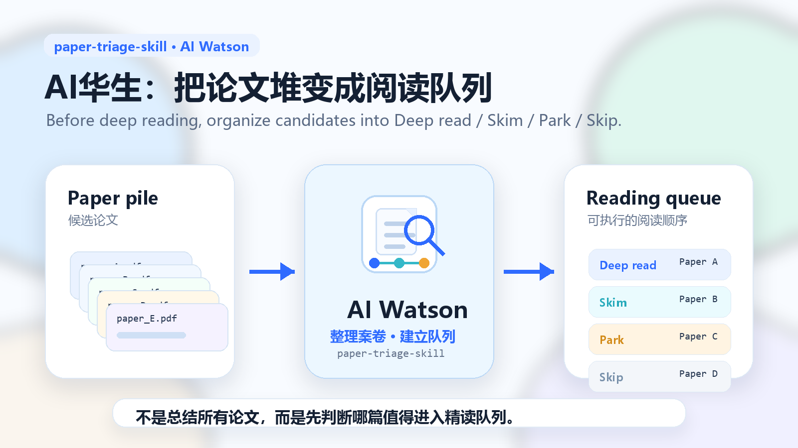

# paper-triage-skill



**AI华生：把论文堆变成阅读队列。**

`paper-triage-skill` is a lightweight Agent Skill for graduate students, researchers, and anyone who needs to sort a pile of candidate papers before deep reading.

It does not try to summarize every PDF at once. Instead, it performs a first-pass paper triage and turns messy candidates into an actionable reading queue:

```text
Paper pile -> AI Watson -> Deep read / Skim / Park / Skip
```

Codename: **AI Watson**.  
Watson organizes the case file before the real investigation begins.


## 一句话

- **给谁**：要开组会、要写综述、被导师丢来一摞 PDF 的硕博生与课题组。
- **解决什么**：把"先读哪篇、从哪儿读、哪些直接跳过"变成一张**带理由**的优先队列，而不是从第一页硬读到最后。
- **怎么验证**：每篇都必须给出分档理由、起读位置和"必须回原文核对的事项"；若结果里出现了你回原文找不到的 DOI／期刊／结论，说明这次输出无效——本技能明确禁止编造。

## How to verify it is working

- Every item carries a reason for its bucket (`Deep read` / `Skim` / `Park` / `Skip`) and where to start reading.
- Every item lists what must be checked in the original paper before citing it.
- No DOI, journal, author, or result is invented. If you cannot find a claim in the source, treat the run as failed.
- The output is a reading plan with handoff material, not a literature review.

## What it does

- Accepts paper titles, abstracts, PDF text snippets, DOI lists, citations, or a research direction.
- Builds a prioritized reading queue.
- Classifies each paper as `Deep read`, `Skim`, `Park`, or `Skip`.
- Explains why each paper is placed in that queue.
- Recommends where to start reading: abstract, introduction, methods, figures, tables, results, limitations, or discussion.
- Lists what must be verified in the original paper.
- Produces handoff material for group meetings, paper cards, Obsidian notes, or a deeper paper-reading workflow.

## What it does not do

- It does not replace full-text reading.
- It does not fabricate literature reviews.
- It does not invent DOI, journal, author, result, or citation information.
- It does not turn a first-pass triage result into a final academic conclusion.
- It does not replace the user's own academic judgment.

## Quick start

Put `skills/paper-triage-skill` into your Codex skills directory, or reference it from a Codex workspace that supports skills.

Example request:

```text
Use paper-triage-skill.

Research direction:
AI-assisted literature review workflows for graduate students.

Current task:
Prepare a 20-minute group meeting. Select 2-3 papers for deeper reading before making slides.

Available reading time:
Two hours tonight.

Here are the candidate paper titles and abstracts:
...
```

Expected output:

- a reading queue;
- recommended action for each paper;
- one concrete reason for each action;
- where to start reading;
- what must be checked in the original paper;
- optional handoff notes for group meeting slides or deeper reading.

## Example output

| # | Paper | Topic fit | Recommended action | Reading effort | Why | Start with | Must verify |
|---|---|---|---|---|---|---|---|
| 1 | Paper A | High | Deep read | Full paper | Directly matches the current task and may contain a reusable screening workflow | Methods + workflow figure | Whether the workflow was evaluated on real papers |
| 2 | Paper B | Medium | Skim | Key sections | Useful background, but not the first priority for paper triage | Tool comparison table | Whether it discusses paper selection or only note storage |
| 3 | Paper C | Low now | Park | Save for later | May help with note export later, but not the current core question | Usage examples | Whether batch export and metadata fields are supported |
| 4 | Paper D | Low | Skip | Do not read now | Too far from the current research task | None for now | Not needed for this group meeting |

More examples:

- [sample-paper-list.md](examples/sample-paper-list.md)
- [sample-triage-table.md](examples/sample-triage-table.md)
- [sample-paper-card.md](examples/sample-paper-card.md)
- [sample-group-meeting-handoff.md](examples/sample-group-meeting-handoff.md)

## Project structure

```text
paper-triage-skill/
├─ README.md
├─ LICENSE
├─ skills/
│  └─ paper-triage-skill/
│     ├─ SKILL.md
│     └─ agents/
│        └─ openai.yaml
├─ examples/
│  ├─ sample-paper-list.md
│  ├─ sample-triage-table.md
│  ├─ sample-paper-card.md
│  └─ sample-group-meeting-handoff.md
└─ media/
   └─ paper_triage_skill_hero_queue_20260705.png
```

## Design principle

The goal is not to read less.

The goal is to make the first decision better:

> Before deep reading, turn the paper pile into a reading queue.

## License

MIT License. See [LICENSE](LICENSE).
